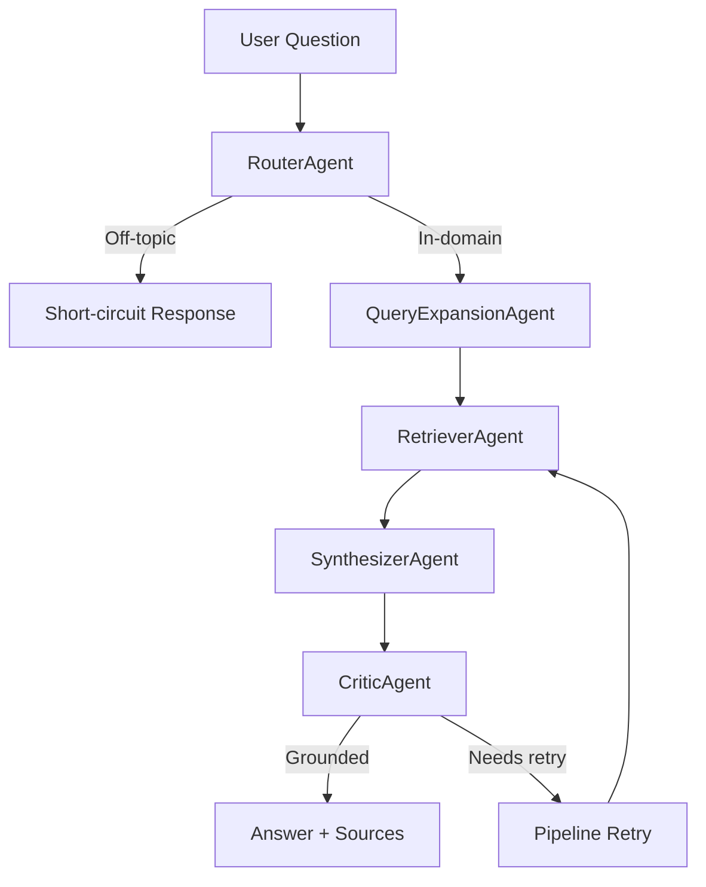

# TUK-ConvoSearch

**A modular, agent-based framework for building domain-specific Retrieval-Augmented Generation (RAG) systems.**

TUK-ConvoSearch explores how a single orchestration architecture can support different knowledge domains through composable agents, configurable pipelines, and interchangeable retrieval stores.

The project currently demonstrates two applications:

- **Cancer Research Assistant:** Retrieves biomedical literature from PubMed and generates answers grounded in research abstracts.
- **Technical University of Kenya (TU-K) Assistant:** Answers university-related questions using official institutional documents.

[](https://github.com/dklemayian100-cloud/tuk_convosearch/actions/workflows/tests.yml)
[](https://opensource.org/licenses/MIT)
[](https://www.python.org/downloads/)

---

## 1. Why TUK-ConvoSearch?

Many RAG implementations begin as a retriever connected directly to an LLM. This is useful for experimentation, but becomes difficult to maintain as requirements grow.

Introducing another domain, changing a retrieval backend, improving answer grounding, or measuring retrieval quality can require changes across multiple parts of the application.

TUK-ConvoSearch addresses this problem through a composable architecture.

Its central design question is:

> How can one RAG orchestration framework support different knowledge domains without requiring a separate implementation for every application?

The approach is to separate the orchestration logic from domain-specific configuration.

Instead of building an entirely new pipeline for every use case, developers can configure:

- Domain-specific routing rules.
- Retrieval stores and knowledge sources.
- Query expansion strategies.
- Answer synthesis prompts.
- Answer-grounding and validation strategies.

The result is a framework designed to make RAG systems easier to extend, test, and evaluate.

## 2. Architecture

TUK-ConvoSearch uses an agent-based pipeline. Each agent has a defined responsibility and operates on a shared `RAGContext`.

### Request lifecycle



### Core components

| Component | Responsibility |
|---|---|
| `RAGContext` | Holds the question, session information, retrieved context, answer, and sources shared across agents. |
| `Pipeline` | Orchestrates agent execution, retries, and short-circuit behavior. |
| `RouterAgent` | Determines whether a question belongs to the configured domain. |
| `QueryExpansionAgent` | Optionally transforms a question into a domain-optimized retrieval query. |
| `RetrieverAgent` | Retrieves relevant documents or chunks from a configured vector store. |
| `SynthesizerAgent` | Generates an answer using retrieved context and source information. |
| `CriticAgent` | Checks answer grounding and determines whether another attempt is necessary. |

### Design principles

**Single responsibility**

Each agent has a clearly defined task. Routing, retrieval, synthesis, and validation are not tightly coupled.

**Composition over duplication**

Different applications can reuse the same pipeline and agents with different configurations.

**Interchangeable components**

Retrieval stores and agent implementations can be replaced without redesigning the entire application.

**Testability**

Core orchestration and agent behavior can be tested independently of live LLM calls and external services.

**Measurability**

An evaluation harness provides a repeatable way to assess routing, retrieval, grounding, citations, and latency.

---

## 3. Demonstration applications

The project demonstrates the same orchestration framework across two distinct knowledge domains.

### A. Cancer research literature assistant

<details>
<summary><strong>Technical implementation</strong></summary>

- **Knowledge source:** PubMed abstracts retrieved through NCBI E-utilities.
- **Embedding model:** `pritamdeka/S-PubMedBert-MS-MARCO`.
- **Retrieval:** FAISS-based biomedical literature retrieval.
- **Query expansion:** LLM-assisted rewriting of clinical and biomedical questions into domain-optimized search queries.
- **Synthesis:** Generates answers constrained by retrieved research context.
- **Critic:** LLM-based faithfulness validation with citation enforcement.
- **Refusal handling:** Deterministic handling of questions for which the available literature does not provide sufficient evidence.

</details>

#### Evaluation results

Reported baseline from a fixed set of 10 evaluation questions:

| Metric | Result |
|---|---:|
| Routing accuracy | 10/10 (100%) |
| Retrieval hits | 9/10 (90%) |
| Grounded answers | 9/10 (90%) |
| Citation presence | 9/10 (90%) |
| Average latency | 37 seconds/question |

The BRCA1 evaluation failure was identified as a knowledge-corpus coverage gap. The system correctly avoided presenting an unsupported answer.

These results represent a project-specific evaluation set, not a clinical performance benchmark.

**Scope:** This application is intended for research-literature exploration. It is not a diagnostic system, clinical decision-support tool, or substitute for professional medical judgment.

### B. Technical University of Kenya Q&A assistant

<details>
<summary><strong>Technical implementation</strong></summary>

- **Knowledge source:** Official TU-K documents, including PDF, DOCX, and TXT files.
- **Embedding model:** `all-MiniLM-L6-v2`.
- **Retrieval:** Local FAISS vector index.
- **Query expansion:** Not enabled in the current configuration.
- **Critic:** Heuristic token-overlap validation.
- **Interaction handling:** Supports lightweight responses, such as jokes, without invoking the full retrieval pipeline.

</details>

Example question:

> When do the second semester examinations start?

The assistant searches the university knowledge base and produces an answer using the retrieved institutional documents.

The two applications share the same core orchestration approach. Their differences are primarily expressed through domain configuration.

---

## 4. Quickstart

### Prerequisites

- Python 3.10 or later.
- [Ollama](https://ollama.com/) installed.
- Git.
- Sufficient disk space for embedding models and local FAISS indexes.

### Clone the repository

```bash
git clone https://github.com/dklemayian100-cloud/tuk_convosearch.git
cd tuk_convosearch
```

### Create a virtual environment

**Windows (Command Prompt):**

```cmd
python -m venv venv
venv\Scripts\activate
```

**Linux / macOS:**

```bash
python -m venv venv
source venv/bin/activate
```

### Install dependencies

```bash
python -m pip install --upgrade pip
pip install -r requirements.txt
```

### Pull the local LLM models

```bash
ollama pull llama3.2:1b
ollama pull llama3.2:3b
```

Ensure Ollama is running before executing a pipeline that requires local model inference.

### Run the tests

```bash
python -m pytest
```

### Try the cancer research pipeline

```python
from app.rag.configs.cancer_pipeline import build_cancer_pipeline
from app.rag import RAGContext

pipeline = build_cancer_pipeline()

context = RAGContext(
    question="What is the mechanism of trastuzumab in HER2-positive breast cancer?",
    session_id="demo",
)

context = pipeline.run(context)

print(context.answer)

for source in context.sources:
    print(f"- {source.source}")
```

### Try the TU-K pipeline

```python
from app.rag.configs.tuk_pipeline import build_tuk_pipeline
from app.rag import RAGContext

pipeline = build_tuk_pipeline()

context = RAGContext(
    question="When do the second semester exams start?",
    session_id="demo",
)

context = pipeline.run(context)

print(context.answer)

for source in context.sources:
    print(f"- {source.source}")
```

**Note:** The examples assume the relevant knowledge indexes have been prepared and the required model dependencies are available. Follow the project documentation for corpus preparation and indexing.

---

## 5. Project structure

The following illustrates the main architectural components:

```text
tuk_convosearch/
│
├── app/
│   ├── api/
│   │   └── chat_proposal.py
│   │
│   ├── services/
│   │   ├── rag_service_proposal.py
│   │   └── database.py
│   │
│   └── rag/
│       ├── core/
│       │   ├── base_agent.py
│       │   ├── context.py
│       │   └── pipeline.py
│       │
│       ├── agents/
│       │   ├── router_agent.py
│       │   ├── query_expansion_agent.py
│       │   ├── retriever_agent.py
│       │   ├── synthesizer_agent.py
│       │   └── critic_agent.py
│       │
│       ├── stores/
│       │   ├── base_store.py
│       │   ├── faiss_store.py
│       │   └── pubmed_store.py
│       │
│       └── configs/
│           ├── tuk_pipeline.py
│           └── cancer_pipeline.py
│
├── evals/
│   ├── questions.py
│   └── runner.py
│
├── tests/
├── docs/
├── pubmed_index/
├── faiss_index/
├── requirements.txt
└── pytest.ini
```

The structure highlights the separation between orchestration, agents, retrieval infrastructure, and domain-specific configuration.

---

## 6. Extending the framework

The primary extension point is the pipeline configuration.

For example, a legal research assistant could reuse the existing orchestration components while introducing legal-specific routing, retrieval, and synthesis behavior.

A hypothetical configuration might look like this:

```python
# app/rag/configs/legal_pipeline.py

from app.rag.core.pipeline import Pipeline
from app.rag.agents import (
    RouterAgent,
    RetrieverAgent,
    SynthesizerAgent,
    CriticAgent,
)
from app.rag.stores.faiss_store import FaissStore

LEGAL_KEYWORDS = [
    "contract",
    "statute",
    "precedent",
    "plaintiff",
    "jurisdiction",
]

LEGAL_PROMPT = """
You are a legal research assistant.

Use only the supplied research context.
Cite the relevant case or statute for each supported claim.
If the context does not contain sufficient evidence,
clearly state that the answer cannot be established.
"""

def build_legal_pipeline(store=None):
    if store is None:
        store = FaissStore(persist_directory="./legal_index")

    return Pipeline([
        RouterAgent(domain_keywords=LEGAL_KEYWORDS),
        RetrieverAgent(store=store),
        SynthesizerAgent(prompt_template=LEGAL_PROMPT),
        CriticAgent(mode="llm"),
    ])
```

This is an architectural illustration. Actual constructor arguments and required dependencies should follow the current implementations of the agents.

### Extension points

| Component | Possible extensions |
|---|---|
| Vector store | FAISS, Chroma, pgvector, PubMed-backed retrieval |
| Router | Keyword-based, LLM-based, hybrid |
| Query expansion | LLM rewriting, domain dictionaries, no expansion |
| Synthesizer | Ollama, OpenAI, Anthropic, or another compatible model implementation |
| Critic | Heuristic, LLM-based, or hybrid validation |

A new domain generally requires three central decisions:

1. Define the domain's routing vocabulary and behavior.
2. Configure the synthesizer's system prompt and answer constraints.
3. Select and prepare the appropriate knowledge source and vector store.

The orchestration layer can then be reused, provided the new configuration satisfies the existing component interfaces.

---

## 7. Testing and evaluation

A RAG system should be evaluated on more than whether its generated answer sounds convincing.

TUK-ConvoSearch separates ordinary unit testing from full-pipeline evaluation.

### Unit tests

Run:

```bash
python -m pytest
```

The project reports 26 isolated unit tests covering core components without requiring live LLM inference or external I/O.

### Evaluation harness

Run:

```bash
python -m evals.runner
```

To save the baseline output:

```bash
python -m evals.runner > evals/baseline.txt
```

The evaluation harness measures:

| Metric | What it measures |
|---|---|
| Route accuracy | Whether the router correctly classifies the question. |
| Retrieval hit | Whether retrieved chunks contain expected information. |
| Grounded answer | Whether the critic accepts the generated answer. |
| Citation presence | Whether the answer includes source references. |
| Latency | How long the pipeline takes to process a question. |

Evaluation results should be compared against a consistent question set when changing retrieval, prompts, models, or agent behavior.

A passing unit-test suite does not, by itself, establish that a RAG system produces accurate answers. Retrieval and generation quality need separate evaluation.

---

## 8. Roadmap

The roadmap distinguishes implemented functionality from future engineering work.

### Implemented

- Modular agent-based pipeline.
- Shared RAG context and orchestration layer.
- Retry and short-circuit pipeline behavior.
- Two domain-specific pipeline configurations.
- FAISS-based retrieval.
- PubMed integration through NCBI E-utilities.
- Citation-aware answer synthesis.
- Grounding validation and refusal handling.
- Unit tests and a repeatable evaluation harness.

### Planned

- Broader CI coverage across supported Python versions.
- Published Python package on PyPI.
- Docker-based deployment.
- Documentation site using MkDocs or Docusaurus.
- Additional vector-store implementations, including Chroma and pgvector.
- Improved streaming support across pipeline stages.
- More comprehensive retrieval and answer-quality evaluations.

### Out of scope

- A hosted SaaS platform.
- Clinical diagnosis or autonomous medical decision-making.
- Multi-tenant authentication.
- Training custom foundation models.

The framework is an engineering and research project focused on modular RAG architecture, not a hosted product or medical device.

---

## 9. Contributing

Contributions are welcome.

Useful areas include:

- Adding a new domain-specific pipeline.
- Implementing a new retrieval store.
- Improving agent interfaces and orchestration.
- Adding evaluation datasets.
- Improving answer-grounding strategies.
- Expanding automated test coverage.
- Improving documentation and examples.

### Before submitting a pull request

Run the test suite:

```bash
python -m pytest
```

Where the changes affect retrieval or generation behavior, run the evaluation harness:

```bash
python -m evals.runner
```

For new agents and stores, include tests that demonstrate their expected behavior.

For new domain configurations, include representative evaluation questions.

For larger changes, open an issue first to discuss the proposed design.

---

## 10. Citation

If you use this project in academic work, you may cite it as:

```bibtex
@software{tuk_convosearch_2026,
  author = {Kirionki, Denis Lemayian},
  title = {TUK-ConvoSearch: A Modular Agent-Based RAG Framework},
  year = {2026},
  url = {https://github.com/dklemayian100-cloud/tuk_convosearch}
}
```

## 11. License

This project is licensed under the MIT License. See [LICENSE](LICENSE) for details.

## 12. Author

**Denis Lemayian Kirionki**

School of Computing and Information Technology  
Technical University of Kenya

GitHub: [@dklemayian100-cloud](https://github.com/dklemayian100-cloud)

Project: [TUK-ConvoSearch](https://github.com/dklemayian100-cloud/tuk_convosearch)

Built with support from the TU-K School of Computing and Information Technology, under the supervision of Mr. Shadrack Ngumbau and Mr. Dalmas Owira.

For questions, bugs, or feature requests, please open a GitHub issue.

---

*Built to explore how modular software engineering can make domain-specific AI systems easier to develop, test, and extend.*